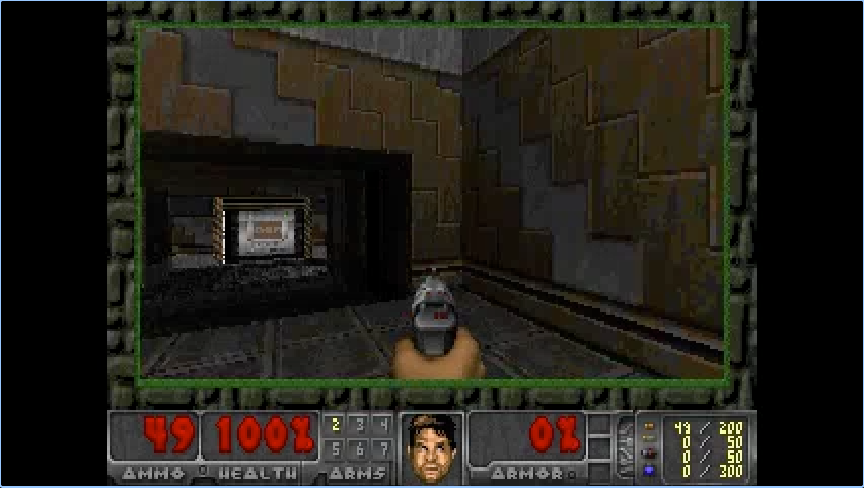

# Game server agent · implementation and verification

## Scope

The deliverable is the Go-led `game-streamer` service and a local browser harness for checking it. The organization’s `api-spec` at revision `b2a0595` supplies the wire contract. Its signed authentication handshake, input sequence numbers and complete snapshots take precedence over the earlier message examples in the assignment. The harness stands in for allocation and the web client during a local demonstration. [Shared protocol definitions](https://github.com/CyberBlock-SPDA/api-spec/tree/b2a0595/protocols)

## Startup and media

1. The agent loads its configuration, connects to the local Agones SDK and reads the named passthrough ports and advertised address from GameServer status. Standalone mode uses explicit environment settings.
2. It verifies the IWAD, starts a TCP-disabled Xvfb server and checks the reported display size. It launches Chocolate Doom into Freedoom Phase 2, waits for a visible window owned by that process, centers it and gives it keyboard focus. The game retains its original aspect ratio inside the 426×240 capture.
3. FFmpeg captures X11 at 30 frames/s and converts to planar YUV420. A small C helper uses FFmpeg’s libavcodec and libx264 to encode Constrained Baseline level 3.1 with an ultrafast preset, zero-latency tuning, no B-frames and a one-second GOP. The default video bitrate is 500 kbit/s.
4. Each encoder packet contains one Annex B access unit. A four-byte network-order length preserves that boundary across the pipe. Go bounds the length, reads the complete packet and writes one timed sample to Pion. Pion packetizes H.264 and handles SRTP and negotiated RTCP feedback. PLI and FIR request a fresh IDR with SPS/PPS from the running encoder. Requests within 100 ms coalesce.
5. After receiving three complete frames, binding the UDP and TCP listeners and loading any TLS certificate, the agent calls Agones `Ready`. A health stream sends immediately and every two seconds. A critical child exit or four seconds without video terminates the session.

## Signaling, input and shutdown

The browser offers a receive-only video transceiver and creates the unordered `game-input` DataChannel with zero retransmissions. Its first WebSocket message on `/ws` carries an Ed25519-signed JWT. The agent verifies the signature, issuer, audience, issued-at, expiry, game ID, token ID and subject. In Agones mode the subject must match the session annotation on this **Allocated** GameServer. Invalid attempts leave the session available. The first successful authentication claims it for one player.

The browser sends its offer, receives the answer and exchanges trickled candidates and completion markers. The agent queues early remote candidates and sends its answer before local candidates. Once both sides finish gathering, the WebSocket may close while DTLS completes. The connection timeout still applies until both WebRTC and the input channel are live.

A persistent XTest connection injects layout-independent key codes, relative mouse motion and three mouse buttons. The controller checks exact message fields, types, safe sequence numbers and bounded movement. It keeps per-control sequence numbers so a late release for one key can still be processed after a newer event for another key. A complete snapshot reconciles held controls. Motion is limited to 120 events/s with a four-event burst. Loss of focus, stale snapshots, channel closure and shutdown all release held input.

The session proceeds from `INITIALIZING` through `READY`, `SIGNALING`, `CONNECTING` and `PLAYING`. The coordinator closes admission, releases controls, closes the peer and stops child process groups in reverse startup order. It sends one Agones `Shutdown` request with a separate deadline. Agones manages Pod deletion and Fleet replacement.

## Configuration

| Setting | Default or source | Purpose |
| --- | --- | --- |
| `STANDALONE`, `SESSION_ID` | `false`, empty | Standalone mode requires an expected session ID and still verifies JWTs. |
| `SESSION_PUBLIC_KEY` | Required | Base64 encoding of the raw 32-byte Ed25519 **public** key. |
| `ALLOWED_ORIGIN` | Same-host WebSocket policy | When supplied, the browser Origin must match this exact scheme, host and port. |
| `TLS_CERT_FILE`, `TLS_KEY_FILE` | Empty | Supply both to serve WSS and HTTPS directly. The Fleet example uses mounted PEM files. |
| `PUBLIC_IP` | Agones status address | Reachable IPv4 address for host ICE candidates. The local demo uses 127.0.0.1. |
| `SIGNALING_PORT`, `WEBRTC_PORT` | 7000 TCP, 8000 UDP locally | In Agones mode the actual ports come from `status.ports`. |
| `DISPLAY`, `SCREEN_WIDTH`, `SCREEN_HEIGHT`, `SCREEN_DEPTH` | `:99`, 426, 240, 24 | Dimensions must be even. Depth is 24 bits. |
| `GAME_EXECUTABLE`, `GAME_IWAD` | `chocolate-doom`, `/usr/share/games/doom/freedoom2.wad` | Game binary and IWAD installed by Debian. |
| `VIDEO_CODEC`, `VIDEO_FPS`, `VIDEO_BITRATE` | `H264`, 30, `500k` | Video-only profile. |
| `INIT_TIMEOUT`, `IDLE_TIMEOUT` | 60s, 120s | Startup limit and maximum time from Ready to an authenticated player. An unclaimed Ready server also expires. |
| `SIGNALING_TIMEOUT`, `CONNECT_TIMEOUT` | 15s, 20s | Authentication/offer and connection deadlines. |
| `INPUT_HEARTBEAT`, `FOCUS_TIMEOUT` | 1s, 30s | Release stale controls or end a prolonged loss of focus. |
| `HEALTH_INTERVAL`, `SHUTDOWN_GRACE` | 2s, 5s | Sidecar heartbeat and process cleanup allowance. The final SDK call gets its own grace period. |
| `AGONES_SDK_GRPC_HOST`, `AGONES_SDK_GRPC_PORT` | localhost, 9357 | Pod-local Agones Go gRPC client. |
| `LOG_LEVEL` | info | Go structured log level. |

## Fleet handoff

The example targets Agones 1.62.0 in namespace `team-1`. For a local cluster, load the built image into its nodes. For a shared cluster, put your published image reference in the Fleet. The separate infrastructure repository currently defines an HTTP-only Deployment. Its owners need to adopt the Fleet, configure the key/certificate and make the allocated TCP and UDP ports reachable. [Fleet manifest](../deployments/fleet.yaml) · [Agones port policies](https://agones.dev/site/docs/reference/gameserver/)

The following commands assume the namespace and Agones already exist, the image is available on the nodes, and the four shell variables point to the deployment’s verification key, frontend origin and certificate files. The certificate must cover the signaling host returned by matchmaking.

```sh
kubectl -n team-1 create secret generic game-streamer-auth \
  --from-literal="public-key-base64=$AGENT_PUBLIC_KEY"
kubectl -n team-1 create configmap game-streamer-web \
  --from-literal="origin=$FRONTEND_ORIGIN"
kubectl -n team-1 create secret tls game-streamer-tls \
  --cert="$TLS_CERT_FILE" --key="$TLS_KEY_FILE"
kubectl apply -f deployments/fleet.yaml
kubectl -n team-1 get gameservers -w
```

The matchmaker must put the opaque session ID in `GameServerAllocation.spec.metadata.annotations["cloudgaming.spda/session-id"]` when allocating from the `doom` Fleet and sign that value as JWT `sub`. Return the actual allocation host and its `signaling` and `webrtc` ports. This annotation is the integration convention chosen here to bind a token to its allocated Pod. The backend and agent share only the verification key’s public half.

A live test is included for use from a client that can route to the allocated host. It consumes **one fresh allocation** and ends it by closing the input channel. Set `LIVE_WS` to its WSS URL, `SESSION_TOKEN` to the fresh token and `ALLOWED_ORIGIN` to the configured frontend origin in the test environment. A private CA can be supplied through `SSL_CERT_FILE`. Start the test from the repository root.

```sh
go test -v -count=1 -run '^TestAllocatedGameServer$' ./internal/stream
```

## Acceptance results

- **Go** — The suite passed with the race detector. It covers signature and expiry failures, rejection of a token for another allocation, concurrent session admission, reordered input and snapshots, deadline transitions, framing and critical process exit. A live pair of Pion peers exercised early ICE before SDP, ICE completion, H.264 RTP after WebSocket closure, DataChannel input and PLI/FIR forwarding. `go vet ./...` passed.
- **Docker** — Built and ran the Linux ARM64 image as UID 10001. Container tests exercised a missing IWAD, an unexpected Doom exit and graceful SIGTERM. A separate encoder test verified a delta frame followed immediately by an explicitly requested IDR with both parameter sets.
- **Browser** — Chrome 157 decoded 426×240 video from the local Docker agent. Escape opened and closed the Freedoom menu over the DataChannel after signaling closed. Mouse movement rotated the view and holding the left button reduced ammunition from 50 to 49.
- **Agones** — A disposable local Kubernetes cluster ran Agones 1.62.0 with the example Fleet. A real allocation supplied two passthrough ports. The test authenticated via WSS with the allocation annotation, received H.264 RTP over UDP, opened the input channel and disconnected. The Fleet created a replacement that reached Ready.
- **Deployment boundary** — Public internet reachability, restrictive NATs, third-party browsers and the university’s deployed matchmaker remain unverified. The media path uses direct IPv4 UDP. A reachable advertised address, matching port mapping and a trusted signaling certificate are deployment prerequisites.


### Local browser measurements

On 26 November 2026, Chrome 157 on macOS received **30.0 frames/s** over a three-second interval from the Linux ARM64 Docker container. At the final observation Chrome reported 288 total video frames and one dropped frame. The WebSocket had already closed.

For five menu openings, elapsed time from the browser keydown event to the first video frame showing the menu was **60, 61, 75, 78 and 111 ms** (median **75 ms**). The check sampled the decoded video with a canvas during video frame callbacks and matched the red menu lettering. These loopback measurements include game input processing, capture, encode, local transport, decode and browser frame-callback scheduling. Public network latency and physical display scanout were outside the measurement.

The cluster check reached `doom-jttmh-8dn2z` on allocated TCP 7975 and UDP 7299. After its session ended, `doom-jttmh-9sd6f` reached Ready. Both addresses and ports belonged to the disposable test cluster.


